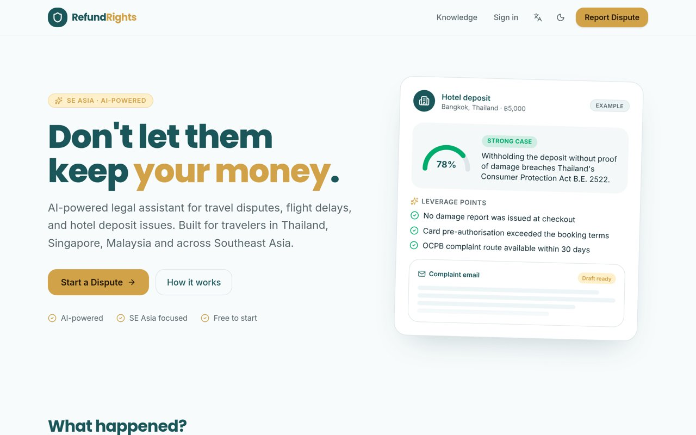
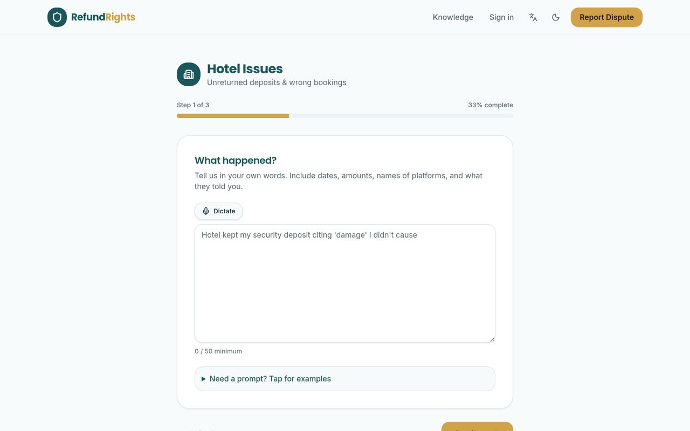
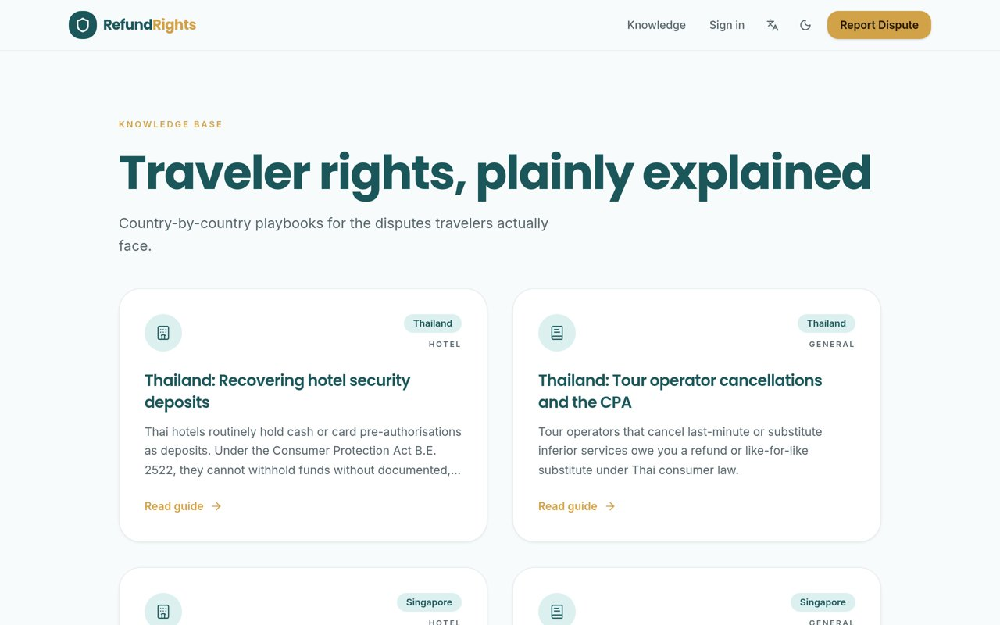
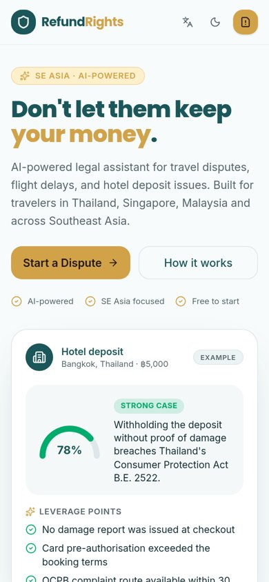
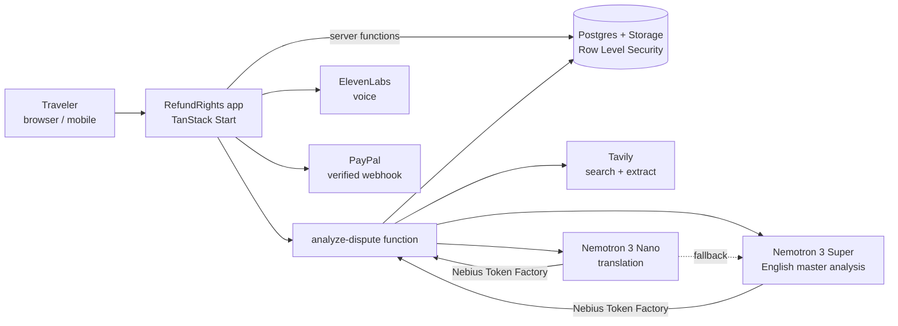

<div align="center">

# 🛡️ RefundRights

**Don't let them keep your money.**
An AI legal copilot that helps travelers in Southeast Asia win back hotel deposits, flight-delay compensation and wrongly refused refunds.

[](https://tokenfactory.nebius.com)
[](https://www.nvidia.com/en-us/ai-data-science/foundation-models/nemotron/)
[](https://tavily.com)
[](https://tanstack.com/start)
[](https://elevenlabs.io)
[](https://developer.paypal.com)

**[🌐 Live demo](https://refundrights.lovable.app)** · **[🎬 Demo video](VIDEO_URL)** · **[🔒 Security](SECURITY.md)**



</div>

---

## The problem

Travelers abroad lose money to unreturned hotel deposits, delayed flights and "non-refundable" bookings that are in fact refundable under local law. The rules are spread across platform fine print and national consumer-protection acts, in languages the traveler may not read, and customer support is designed to wear people down.

## What it does

Describe what happened, pick the country, attach your receipts — RefundRights returns a **Rights Analysis** in under a minute:

- 🎯 **Risk gauge & verdict** — how strong your case is, with a confidence score
- ⚖️ **Legal leverage points** — the specific laws and platform clauses that back you (e.g. Thailand Consumer Protection Act B.E. 2522, Singapore CPFTA)
- ✉️ **Ready-to-send complaint email** — firm, factual, editable, bilingual on request
- 🔗 **Cited live sources** — every claim links to the policy or law page it came from

## Screenshots

| Claim wizard | Knowledge base | Mobile |
|---|---|---|
|  |  |  |

## Feature highlights

| | Feature | Why it matters |
|---|---|---|
| 🤖 | **Multi-agent analysis** — Evidence, Legal, Finance and Localization agents in one structured Nemotron call | Authoritative, consistent reasoning |
| 🔎 | **Live grounding with Tavily** — search + extract from an allowlist of platform and official law pages | No hallucinated laws; sources labelled in the report |
| 🌏 | **English master + translations** — other languages translate the master, never re-analyse | Same verdict, confidence and argument count in every language |
| 🎙️ | **Voice in / read aloud** (ElevenLabs Scribe + TTS) | Tell your story hands-free; listen to the report |
| 📋 | **Case tracker & dashboard** — status timeline, next steps, total recovered | Follow a dispute to the end |
| 📄 | **PDF export & mailto** | Send the complaint in one click |
| 💳 | **Free preview, paid full report** — PayPal (Sandbox) or special code | Server-enforced paywall |
| 🙋 | **Human expert help form** | Escalation without exposing a private email |
| 🌗 | **EN / 中文 / Nederlands, light & dark mode, mobile-first** | Built for travelers on the go |

## Architecture



| Model (Nebius Token Factory) | Role |
|---|---|
| `nvidia/nemotron-3-super-120b-a12b` | Reasoning-heavy multi-agent legal analysis, structured output via function calling |
| `nvidia/NVIDIA-Nemotron-3-Nano-30B-A3B` | Fast, cheap report translation; auto-falls back to Super if output is invalid or untranslated |

## Nebius × NVIDIA hackathon compliance

- ✅ **Runs on Nebius Token Factory** — `https://api.tokenfactory.nebius.com/v1/chat/completions`
- ✅ **Uses NVIDIA open models** — Nemotron 3 Super and Nemotron 3 Nano (tiered)
- ✅ **Track:** Best Apps and Agents
- Code: `supabase/functions/analyze-dispute/index.ts`. The model name is stored with every analysis (`dispute_analyses.model`) and shown in the report.

## Tech stack

| Layer | Tech |
|---|---|
| Frontend | React 19, TanStack Start / Router, Tailwind CSS v4, shadcn/ui |
| Backend | Lovable Cloud (Postgres, Auth, Storage, edge functions), TanStack server functions |
| AI | NVIDIA Nemotron 3 on Nebius Token Factory |
| Grounding | Tavily Search + Extract |
| Voice | ElevenLabs Scribe & TTS |
| Payments | PayPal Orders API + signature-verified webhooks |
| Tests | Vitest |

## Run locally

```bash
git clone <this-repo> refundrights && cd refundrights
bun install
cp .env.example .env        # fill in your own backend URL / publishable key
bun dev                     # http://localhost:8080
bunx vitest run             # run the test suite
```

Server-side secrets (below) are set in your backend's secret store, never in `.env` or the repo.

## Configuration

| Secret | Used for | Where to get it |
|---|---|---|
| `NEBIUS_API_KEY` | Nemotron analysis & translation | Nebius Token Factory console |
| `TAVILY_API_KEY` | Live legal/policy search and page extract | tavily.com dashboard |
| `ELEVENLABS_API_KEY` | Read-aloud and voice input | ElevenLabs dashboard |
| `PAYPAL_CLIENT_ID`, `PAYPAL_CLIENT_SECRET`, `PAYPAL_WEBHOOK_ID`, `PAYPAL_ENV` | One-time report unlock (Sandbox by default) | PayPal Developer dashboard |
| `SPECIAL_UNLOCK_CODE` | Optional promo unlock code | Choose your own |

## Security & privacy by design

- 🔐 **Row Level Security** on every table and on evidence storage — users only ever touch their own cases
- 💰 **Server-enforced paywall** — full report content is served only by a server function, redacted until paid
- ✅ **Unlock only via signature-verified PayPal webhook** or server-checked special code
- 🌐 **SSRF-safe fetching** — only allowlisted platform and government domains are extracted
- 🧹 **Data minimisation** — no full payment payloads stored, audit/rate-limit logs expire after 90 days, search queries contain only country, category and platform
- 🗑️ **Self-service deletion** of all your data from the Privacy page
- 🔑 **No secrets in the repo** — names only; see [SECURITY.md](SECURITY.md)

## Project structure

```text
src/routes/            pages (home, claim wizard, analysis, dashboard, knowledge, help, privacy) + api/public webhooks
src/components/        UI (CaseTracker, HeroPreviewCard, voice controls, …)
src/lib/               server functions, paywall, case status, i18n, tests
supabase/functions/    analyze-dispute (multi-agent Nemotron pipeline)
supabase/migrations/   schema + RLS policies
docs/screenshots/      README images
```

## Roadmap

- PayPal Live mode and refund policy
- More countries (Philippines, Indonesia deep coverage) and languages
- Nemotron 3 Ultra for complex multi-party disputes
- Admin console for human expert requests
- Background re-checks of platform policy changes (Nebius Serverless Jobs)

## Disclaimer

RefundRights provides AI-generated information, not legal advice. Example cases in the app are fictional.

## License

This project is licensed under the [MIT License](LICENSE).

Copyright © 2026 Beiyuezou
